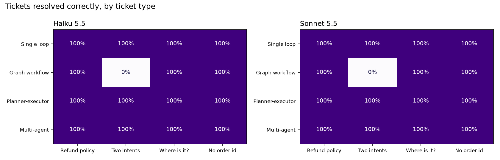
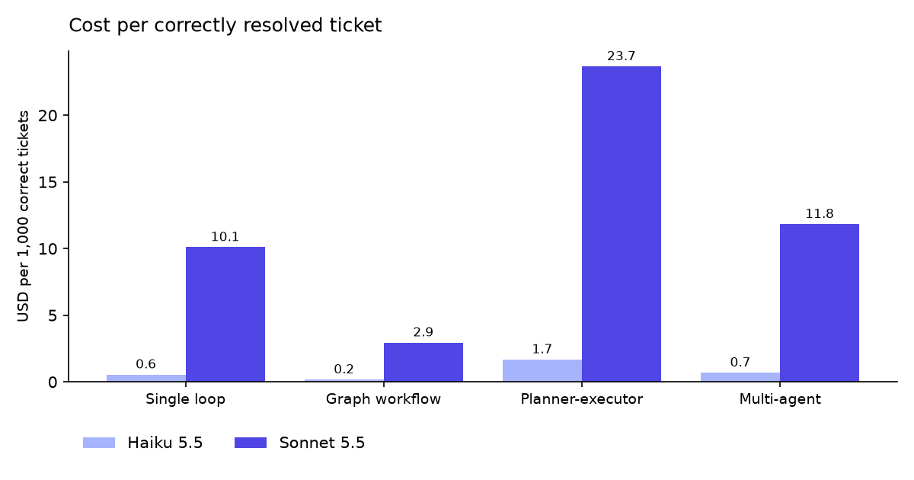
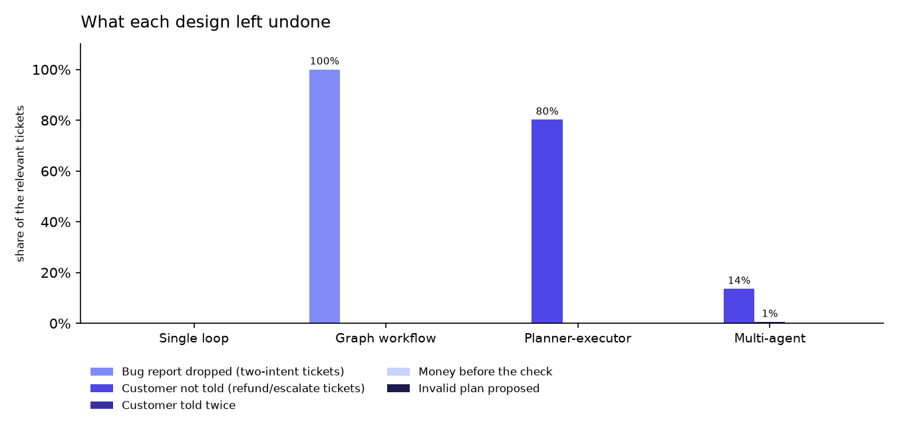
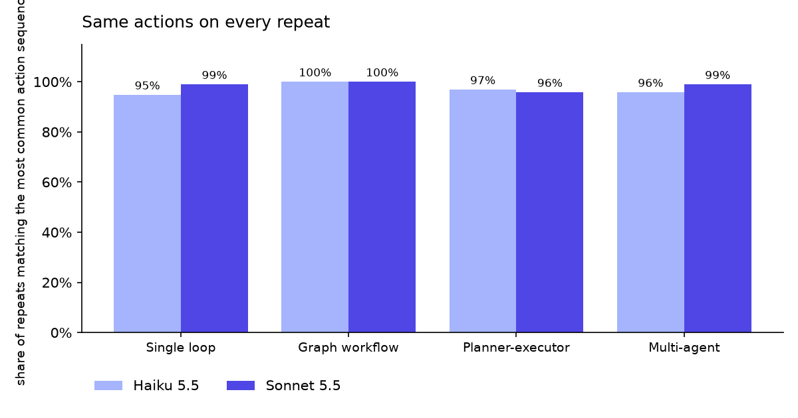

# Results: Four Shapes, One Ticket

Run on 2026-11-20 with Claude Haiku 5.5 and Claude Sonnet 5.5 (adaptive thinking, effort `medium`). **768 episodes, USD 4.88.** 16 tickets × 4 designs × 2 conditions × 2 models × 3 repeats; no errors, no duplicate rows. Every number below comes from [`results/episodes.jsonl`](results/episodes.jsonl) through `uv run python -m four_shapes.report`.

## The headline

**On this task the shape decided cost and what got left undone, not correctness.** Three designs (single loop, planner-executor, multi-agent) resolved **all 576** of their tickets correctly, on both models, faults included. None of them ever moved money before checking the return window. The graph workflow resolved every ticket its paths were built for. It **silently dropped the bug report on every two-intent ticket**: all 48 were classified as a refund, the refund half was handled correctly, and the bug went nowhere. In exchange it was the cheapest by far and the most predictable.

| | Single loop | Graph workflow | Planner-executor | Multi-agent |
|---|---|---|---|---|
| Correct, all tickets (Haiku / Sonnet) | 100% / 100% | 75% / 75% | 100% / 100% | 100% / 100% |
| Two-intent tickets correct | 100% / 100% | **0% / 0%** | 100% / 100% | 100% / 100% |
| Recovered from the fault | 48/48 / 48/48 | all its paths (36/48 incl. two-intent) | 48/48 / 48/48 | 48/48 / 48/48 |
| Same actions on every repeat | 95% / 99% | **100% / 100%** | 97% / 96% | 96% / 99% |
| LLM calls per ticket | 5.0 | **2.0** | 6.7 / 6.2 | 5.5 |
| Median latency (Sonnet) | 8.0 s | **3.8 s** | 15.8 s | 8.6 s |
| Cost per correct ticket, Sonnet | $0.0101 | **$0.0029** | $0.0237 | $0.0118 |
| Customer not told after a refund or escalation | 0% | 0% | **80%** | 14% |






## The hypothesis, claim by claim

**1. The graph workflow is the most predictable, with the fewest policy-order violations: partly.** It took the same actions on every repeat of every ticket (100%, against 95–99% for the others); code decides its path, so only the wording of its replies varies. But the violation half had nothing to separate: **no design ever moved money before a successful eligibility check** (0 of 768). Given the policy text, both models checked first every time, including the single loop the article worries about most.

**2. The graph workflow is the weakest on unexpected input: confirmed, and it failed silently.** On two-intent tickets the graph scored 0% against 100% for the other three. Its single-intent classifier (the article's design) took the refund path all 48 times and **never used the fallback edge to a human**. So the customer got the right refund decision, and the website bug they reported went nowhere, with nothing in the run marking it as a failure. On the two other off-path kinds (no order id, delivery question) the graph scored 100%, because those paths were built.

**3. The planner proposes invalid plans at a measurable rate, and validation recovers most: wrong.** Across 276 plans (192 first plans and 84 replans), **not one** failed validation: no invented tools, no refund before the check. Replanning did its job on real failures: all 48 faulted planner episodes replanned after the 503 and finished correctly. The validator never fired. That doesn't make it pointless, though: it is the only thing that would stop a bad plan, and this task never produced one.

**4. Multi-agent costs the most and brings handoff failures: wrong.** The **planner-executor** cost the most: 2.3× the single loop per correct ticket on Sonnet and 3.1× on Haiku, at twice the latency (15.8 s median). Multi-agent cost 17% more than the loop on Sonnet (25% on Haiku). Its handoffs were clean: no handoff failed the code checks, and only 1 ticket in 192 got two replies. Its real cost was the 14% of money tickets where nobody told the customer what happened.

**5. On ordinary refund tickets all four reach the policy outcome within 5 points: confirmed.** All four scored 100% on the 8 refund-policy tickets, on both models.

## What the run showed that the hypothesis didn't ask

**The planner did exactly what was required, and nothing else.** On refund and escalation tickets the policy requires the money action, not a reply. The planner's plans followed that literally: in 80% of those tickets (Haiku 94%, Sonnet 67%) the customer never heard back. It isn't graded as a failure here, because the policy text never asks for a reply, but a real customer would notice. The single loop and the graph replied every time (the graph because its last node always drafts one). The multi-agent billing agent skipped it 14% of the time.

**The graph's price advantage is structural.** Two LLM calls per ticket (classify, draft) against five to seven for the others, with the policy decision in plain code: about **3.4× cheaper per correct ticket than the single loop**, even counting its two-intent misses, and half the latency. Each LLM call it makes sees only what that node needs (about 1,400 input tokens per ticket, against 12,000 for the loop).

**Faults were easy for everyone.** A single retryable 503 never broke any design: the loop and the agents retried, the graph's code retried, and the planner replanned. One transient failure isn't a stress test; the next step is in the list below.

## What this does and doesn't show

- **It shows** that on a well-specified support task with a clear written policy, all four shapes can be correct. The choice between them is about cost, latency, predictability, and what each one leaves undone.
- **The graph's miss is by design** (one intent per ticket), as the article describes. A multi-label classifier plus an engineering branch would fix it. That's the point: the graph only does what its paths encode, and it fails quietly when a ticket falls outside them.
- **The planner's and agents' silence is a specification gap**, not a model error: they did what the policy asked. A loop that replies anyway is being helpful beyond the spec, which you may or may not want.
- **Limits:** 16 tickets, one domain, three repeats per cell. One fault type. Prompts written by me for each design, though every design gets the same policy text. The article's table rates other things (permission isolation, observability effort) that a ledger can't measure.

## Next steps

- Give the graph a multi-label classifier and an engineering branch; re-run the two-intent tickets.
- Add "always reply to the customer" to the policy and see whether the planner's and agents' silent gap closes.
- Harder faults: repeated failures, a tool that times out after acting (the article's "did the money move?" case).
- A larger tool set, where the single loop's "every tool is another move at every step" should start to cost it.

## Reproduce

```bash
uv sync
uv run pytest
uv run four-shapes --dry-run
uv run python -m four_shapes.report   # rebuilds every table and chart from the committed episodes
```
