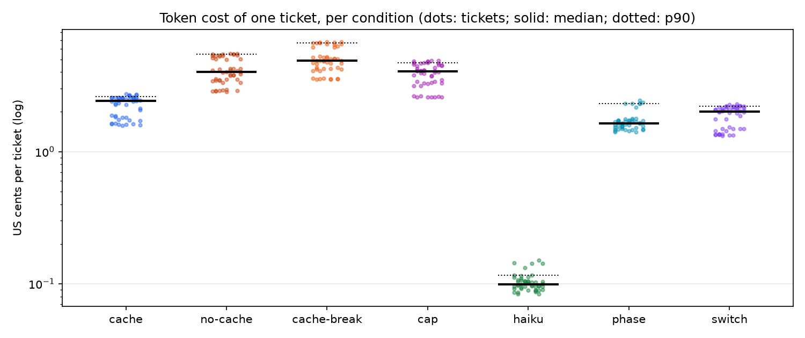
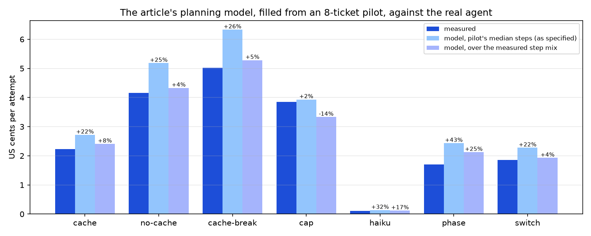
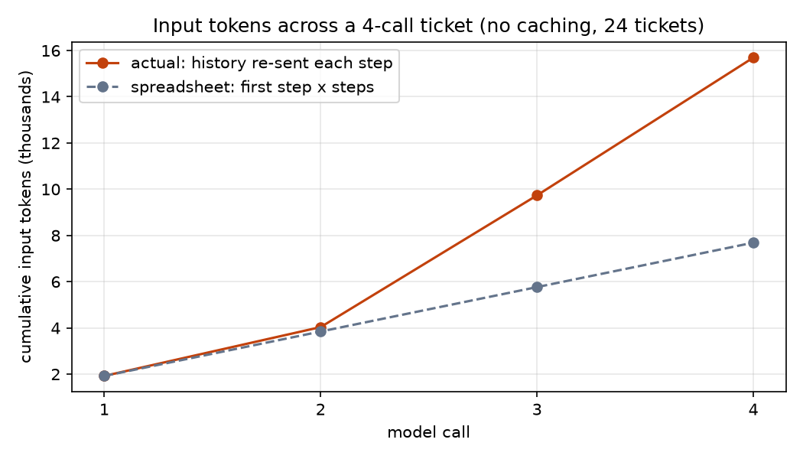

# Results: The Bill for One Ticket

Run on 2026-11-21 with Claude Sonnet 5.5 and Haiku 5.5 (effort `medium`). **336 tickets (24 tickets × 7 conditions × 2 repeats), USD 9.09.** There were no failed jobs and no duplicate rows, and every job's tag is unique. Every number below comes from [`results/tickets.jsonl`](results/tickets.jsonl) through `uv run python -m bill.report`.

**Spend, all in: about USD 12.03.** The cache-minimum check added a fraction of a cent.
- **USD 9.09** for the clean run reported here;
- **USD 1.47** for the pilot;
- **USD 1.47** for a first full run, stopped when I found a flaw (next section). Both of those earlier runs are kept in [`results/shared-cache-v1/`](results/shared-cache-v1).

**Two repeats, not the planned three.** The pilot cost about twice the estimate, and three repeats would not have fitted the USD 12 cap.

## The headline

**On this agent's real tickets, a cheaper model was by far the biggest lever, caching the next.** The article's planning model ranked the other levers correctly once it was given real step counts.

Every ticket was resolved on its first attempt under every condition: no handoffs, no abandoned tickets, no retries. So the bill here is tokens only. The human-time terms the article prices never arose.

| Condition | Token cost per ticket (median / p90) | vs cached baseline | Cache hit | Article's model, as specified / over the step mix |
|---|---|---|---|---|
| `cache` (Sonnet, cached) | 2.23¢ (2.42 / 2.62) | n/a | 67% | +22% / +8% |
| `no-cache` | 4.16¢ (4.02 / 5.44) | **+86%** | 0% | +25% / +4% |
| `cache-break` | 5.02¢ (4.90 / 6.63) | **+125%** | **0%** | +26% / +5% |
| `cap` (history cap 2) | 3.86¢ (4.04 / 4.70) | +73% | 24% | +2% / −14% |
| `haiku` | **0.10¢** (0.10 / 0.12) | **−95%** | 68% | +32% / +17% |
| `phase` (2 Haiku calls, then Sonnet) | 1.71¢ (1.64 / 2.32) | −24% | 55% | +43% / +25% |
| `switch` (alternate every call) | 1.86¢ (2.02 / 2.22) | −17% | 35% | +22% / +4% |

Each row covers 48 tickets. A ticket averaged 4.5 model calls under every condition.




## A flaw found in the pilot, and how the run handles it

**Every condition sent the same first message for the same ticket, so a condition run a few minutes after another read the earlier one's cache.**
- In the first pilot, Haiku's first `phase` call wrote 0 tokens and read 1,909. The `haiku` condition had just cached that exact prompt for the same ticket.
- Sonnet's first call in `phase` read 2,100 tokens it had never written; the `cache` condition left them.

That made the routing conditions look far cheaper than they are. Against that data, the article's model looked 115–288% wrong on routing.

**The fix:** every job now carries a random tag in its first message, so no two jobs can share a cached prompt. A retry keeps its job's tag, because a real retry would resend the same prompt. A test checks it. I stopped the first full run (USD 1.47 spent), archived both runs, and reran everything.

**One related observation:** even without the confound, tickets never shared the tools and system prompt they have in common. Every ticket's first call wrote all ~1,920 prefix tokens and read none. Automatic caching places its one breakpoint at the end of the conversation, so the shared prefix is never cached on its own. Sharing it across tickets would need an explicit breakpoint after the system prompt. The article's *"sharing the stable prefix across tickets needs traffic dense enough to keep it warm"* also needs that breakpoint.

## The hypothesis, claim by claim

**1. History makes input grow faster than linearly: confirmed.** Measured on the uncached runs, a ticket's real input was **2.10×** what "first step × number of steps" predicts, and its cost 2.09×. That's at only 4.5 calls; the article's 20-step example implies 10.5×. The spreadsheet error it warns about is real, and it grows with every step.



**2. Prompt caching is the biggest token lever: confirmed, among the structural levers.** Turning caching off raised cost per ticket by 86%. That's more than the history cap (+73%), and the routing levers saved only 17–24%. Only a broken cache cost more, and that is the same lever failing. A cheaper model beat it (claim 6).

**3. A cache break is silent and expensive: confirmed, and worse than no caching.** With a timestamp at the top of the system prompt, every call wrote its whole prompt again at the 1.25× write rate. Cost rose **125%**, which is 21% more than turning caching off. The cache-hit rate was 0%, and nothing raised an error; only the cache fields showed it.

The cache-minimum check confirms the second half too. A 436-token prompt sent twice came back with 0 tokens written and 0 read, both times, with no error, on both models. An 8,262-token prompt was written once and read the second time ([`results/cache_min_check.json`](results/cache_min_check.json)).

One difference from the article. It says a change invalidates "that level and everything after it", which would leave the tool definitions cached. With automatic caching, nothing at all was reused, not even the tools, because there was no breakpoint before the system prompt.

**4. Routing pays only when it keeps the cache: partly.**
- **Phase routing confirmed:** it saved 24%. Its Haiku calls cost almost nothing, and the handover cost one full write on Sonnet, as the article describes.
- **Switching on every call disconfirmed:** it was **17% cheaper** than the baseline, not more expensive, even though its cache-hit rate fell to 35%.

At these prices Haiku costs 1/20 of Sonnet, against the article's illustrative 1/5. Half the calls at 1/20 of the price outweighs the lost cache. The article's own model, filled with real prices, predicts the same.

**5. A history cap loses on a short run: confirmed.** Capping history at two exchanges raised cost by 73%. The running summaries were cheap (USD 0.0004 per ticket, written by Haiku). The cost came from the cap rewriting the window on every call once it started folding history: from that point every call missed the cache and Sonnet rewrote 3–6k tokens.

**6. A cheaper model is a weaker lever than structure: wrong, here.** Haiku cut cost per ticket by **95%** against caching's 46%, and it resolved every ticket, as Sonnet did. The article's argument rests on failure costs: a cheaper model that fails more often hands its savings to the people who pick up its tickets. On these tickets neither model failed, so there was nothing to dilute the saving.

The tickets were well defined and the policy decisions came pre-computed from the tools. On harder, ambiguous tickets the argument may hold. These runs can't show it.

**7. The planning model predicts each condition within ±25% and ranks the levers: partly.**
- **As specified,** filled from 8 pilot tickets with their median of 5 steps, it was within ±25% for 4 of 7 conditions. It was too high on `cache-break` (+26%), `haiku` (+32%) and `phase` (+43%).
- **The bias has one cause:** the model takes a whole number of steps, and real tickets averaged 4.5. Averaged over the measured mix of step counts, all seven predictions landed within ±25%, and four within ±10%.
- **The ranking** was right except for one adjacent pair: the model put `switch` below `phase`, which measured 0.16¢ apart.

So the model's structure holds up. What it needs is a distribution of steps, not a single number. The article does say to "run the model at the median and at the worst case".

## What the run showed that the hypothesis didn't ask

- **Steps were short:** 4.5 calls per ticket, not the article's illustrative 12. At that length the quadratic history term is modest. The prefix and the first lookup's 1,300-token record are most of every prompt.
- **The tail is short:** the p90 ticket cost at most 41% more than the median (`phase`), and 8% more under the cached baseline. These tickets have no long tail, so the article's warning that "a few runaway tickets can dominate the bill" didn't apply to this task.

## What this does and doesn't show

- **It shows** the article's cost mechanics on a real agent:
  - quadratic history;
  - caching's large saving;
  - a cache break that is silent and costs more than no cache;
  - a history cap that loses on short runs;
  - phase routing that pays.

  It also shows the article's planning model predicting real costs within ±25%, once it is given real step counts.
- **It doesn't show** the human-cost side of the argument: every ticket was resolved by every model. Nor does it show the architecture multiplier, which experiment 3 measured separately.
- **Limits:** one task family of well-defined tickets, 24 tickets × 2 repeats per condition, one pricing table, and automatic caching only (no explicit breakpoints).

## Next steps

- Harder tickets, ambiguous or with missing information, where a cheaper model fails. That is the test the article's "weaker lever" claim needs.
- Explicit cache breakpoints after the tools and the system prompt, to measure prefix sharing across tickets.
- A planning model that takes a distribution of step counts.

## Reproduce

```bash
uv sync
uv run pytest
uv run bill-for-one-ticket --dry-run
uv run python -m bill.report   # rebuilds every table and chart from the committed tickets
```
