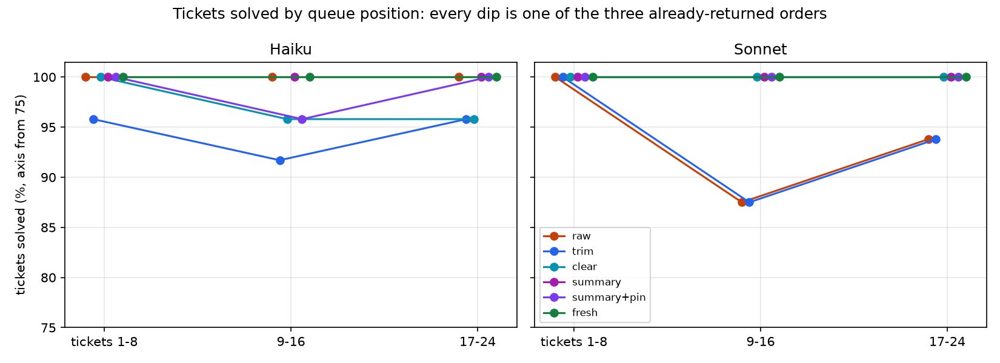
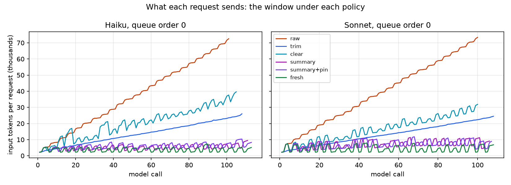
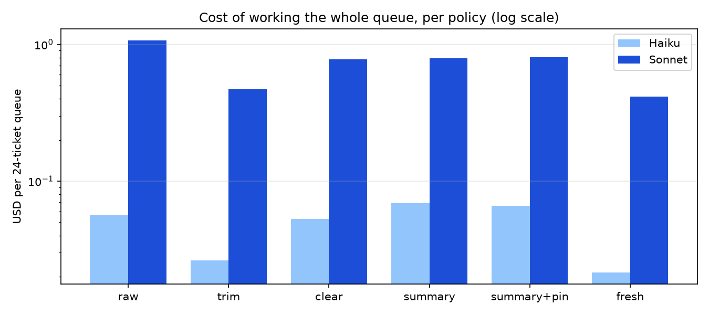
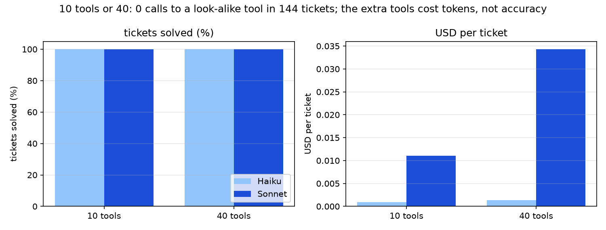

# Results: Ticket Thirty

Run on 2026-11-21 with Claude Haiku 5.5 and Claude Sonnet 5.5 as the agent (effort `medium`) and Haiku as the summariser. **30 queues of 24 tickets (720 tickets) and 144 tool-count episodes, USD 10.77 including the pilot.** No failed runs and no duplicate rows. Every number below comes from [`results/runs.jsonl`](results/runs.jsonl) through `uv run python -m ticket_thirty.report`.

**The matrix is smaller than planned for Sonnet.** The pilot measured Sonnet's queues at about 20× Haiku's cost (a `raw` queue: $1.08), so the full matrix would have needed about $21 against a $15 cap. Sonnet therefore ran **2 queue orders, not 3**, and **1 tool-study repeat, not 2**. Haiku ran everything.

## The headline

**No context rot appeared inside the tool loop, and no standing instruction was lost.**
- **No decline:** under `raw` the window grew to 72–73k tokens by the last ticket, and neither model got worse from the first third of the queue to the last.
- **The freeze held everywhere:** across all 30 queues it was never broken. That's 0 escalations on 150 frozen-refund tickets, including under the unpinned summary.
- **The audit flag held:** it was kept on 719 of 720 tickets.

What the remedies changed was **cost**, not accuracy: trimming cut Sonnet's cost per queue by 56%, and a fresh window per ticket by 61%.

| Policy | Solved, Haiku / Sonnet | Unambiguous tickets solved, Haiku / Sonnet | Mean window (tokens) | Final window | Cost per queue, Haiku / Sonnet |
|---|---|---|---|---|---|
| `raw` | 100% / 94% | 100% / 100% | 37.6k / 37.3k | 73k / 72k | $0.056 / $1.07 |
| `trim` | 94% / 94% | 100% / 100% | 13.7k / 13.1k | 26k / 24k | $0.026 / **$0.47** |
| `clear` | 97% / 100% | 100% / 100% | 19.5k / 16.6k | 37k / 32k | $0.053 / $0.78 |
| `summary` | 100% / 100% | 100% / 100% | 5.7k / 6.5k | 10k / 10k | $0.069 / $0.79 |
| `summary+pin` | 99% / 100% | 98% / 100% | 5.5k / 6.8k | 8k / 10k | $0.066 / $0.81 |
| `fresh` | 100% / 100% | 100% / 100% | 3.7k / 4.3k | 5k / 7k | **$0.021** / **$0.41** |

Haiku ran 3 queues per policy (72 tickets) and Sonnet 2 (48). "Unambiguous" leaves out the three tickets explained in the next section. Across all policies and models, agents solved **629 of the 630** unambiguous tickets.





## Two design flaws, and how the analysis handles them

**1. Three tickets were over orders that were already returned.** My ticket builder, inherited from experiment 3, never checked an order's status. Three of the 24 orders (T-Q008, T-Q009, T-Q013) are marked `returned` in the Kestrel data, and the policy expects a refund (or a "delayed" reply). On 12 of their 90 appearances the agent handed the ticket to a human instead. Sonnet explained why: *"the order status is already 'returned', so a refund may have been issued before."* That is defensible, arguably correct, and my grader scored it a failure.
- **Every failure in the table but one is one of these handoffs.**
- They never happened under `fresh`, and never in the tool study, where the same three tickets ran alone 18 times.
- Three queues handed all three returned orders to a human, all of them in queue order 1 (Haiku `trim`, Sonnet `raw`, Sonnet `trim`). Three other queues mixed their treatment.

So the long window seems to have made the agent more willing to notice the anomaly. These runs can't say why. The column "unambiguous tickets solved" leaves the three out. A rerun should drop returned orders from the ticket builder.

**2. The first stub wording broke `clear`.** In the pilot, a cleared result read *"[cleared after T-Q005 closed: order_status(order_id=…). Call it again if needed.]"*. Haiku took this to mean it had never received any real data. On ticket 11 it wrote: *"Every tool result I received in this session was a placeholder, not ticket data… I need to stop the queue."* It then took no action on 9 of the 24 tickets.

The stub now says what happened: *"Result removed from the context after T-Q005 was finished, to save space. You received the full result at the time and acted on it…"*. With that wording, `clear` solved 23/24 on the same queue. The first run is kept in [`results/pilot/`](results/pilot).

## The hypothesis, claim by claim

**1. Context rot shows up inside a tool loop: wrong, here.** Under `raw`, Haiku solved 100% of tickets in every third of the queue. Sonnet's only misses were the returned-order handoffs, at positions 12, 16 and 21 of one queue order. Both models kept the freeze and the audit flag on every ticket, up to a 73k-token window. A 24-ticket queue with explicit, labelled instructions didn't push either model into rot.

**2. Trimming at the tool boundary removes most of the input, with no worse accuracy: confirmed.**
- **The window:** the mean window shrank by 64–65% (37k to 13k tokens).
- **Cost:** it fell by 56% on Sonnet and 53% on Haiku.
- **Accuracy:** unchanged on unambiguous tickets (100%).

There was no decline for it to remove. Trimming did make the returned-order handoffs *more* common on Haiku (4 against 0 under `raw`). In the trimmed output the order status sits in the first line, with nothing else around it.

**3. Clearing stale results is nearly lossless: partly.** With a stub that says what happened, `clear` matched `raw` (100% of unambiguous tickets on both models) and cut the mean window by 48–55%. Two caveats:
- **The stub wording matters:** the first wording cost 9 tickets (see above).
- **Cost fell much less than tokens:** 27% on Sonnet and 6% on Haiku. Clearing changes the transcript's prefix, so the cache is rebuilt once per ticket: `clear` wrote 1.7× more to the cache per call than `raw`. The article warns of exactly this.

**4. An unpinned summary loses constraints: wrong.** All 230 running summaries kept both instructions, under both summary policies and both models. The unpinned `summary` broke the freeze 0 times and dropped the audit flag 0 times.

The generic summariser was never asked to keep instructions, yet it wrote its own **"Standing instructions"** section and copied both rules almost word for word. The opening message called them "two standing instructions", and that label seems to have been enough.

The one summary failure was a different kind. On T-Q008, Haiku decided its own reply needed a corrected sign-off and asked for approval. The summary carried that self-made "open item, pending user approval" forward, and later the agent stopped to ask about it instead of working. This happened in `summary+pin`: pinning protects instructions, not the rest of the summary. It is the article's *"a bad summary fails silently"*, as a stale open loop rather than a lost constraint.

**5. A fresh window per ticket is the accuracy ceiling, and the cheapest: confirmed.** `fresh` solved 100% of tickets on both models, including the three returned-order tickets every time. It was the cheapest policy: $0.41 per Sonnet queue against $1.07 for `raw`, and $0.021 against $0.056 on Haiku. Its price, as the article says, is carrying nothing between tickets, which this queue never needed.

**6. Tool selection degrades with 40 similar tools: wrong, here.** In 144 single-ticket episodes, no agent called any of the 30 look-alike tools, and every ticket was solved with 10 tools and with 40. The extra tools cost tokens only: the window grew from about 4k to 7k. Sonnet's cost per ticket tripled ($0.011 to $0.034), mostly from cache writes. The article cites selection degrading beyond 30–50 tools; 40 tools with plain, distinct descriptions wasn't enough to show it.



## What this does and doesn't show

- **It shows** that in a realistic support loop, up to a 73k-token window, two current Claude models kept explicit standing instructions and solved tickets as well at ticket 24 as at ticket 1. The context remedies are worth applying for **cost**: trimming and fresh windows halved or better the bill at the same accuracy.
- **It doesn't show** that context rot can't happen in agents. The window stayed under 75k tokens. The instructions were short, explicit and labelled. The tickets were independent. The tools stated each decision, so no step needed long-range recall.
- **Limits:** one task family, 24 tickets, 2–3 queue orders per cell, two models from one family, a reduced Sonnet matrix, and the two flaws above.

## Next steps

- Drop returned orders from the ticket builder, and rerun.
- **Harder for the window:** a queue of 60–100 tickets past 150k tokens; instructions phrased casually mid-conversation rather than labelled up front; tickets that depend on earlier ones (a refund promised at ticket 5 and cancelled at ticket 20).
- A summariser told to drop "old" instructions, to measure what pinning actually protects.
- Look-alike tools with overlapping descriptions, not just similar names.

## Reproduce

```bash
uv sync
uv run pytest
uv run ticket-thirty --dry-run
uv run python -m ticket_thirty.report   # rebuilds every table and chart from the committed runs
```
