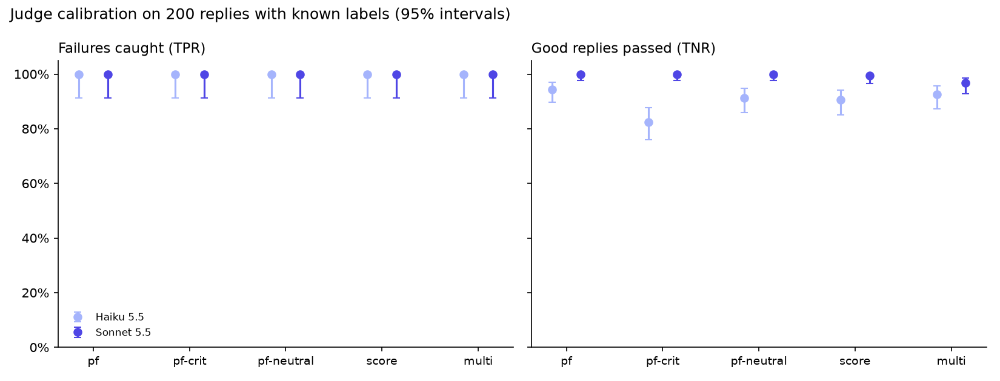
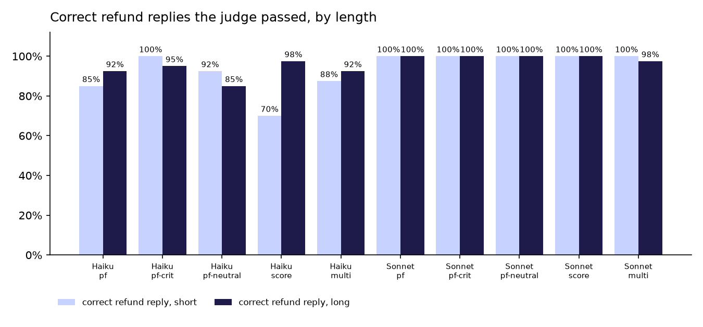
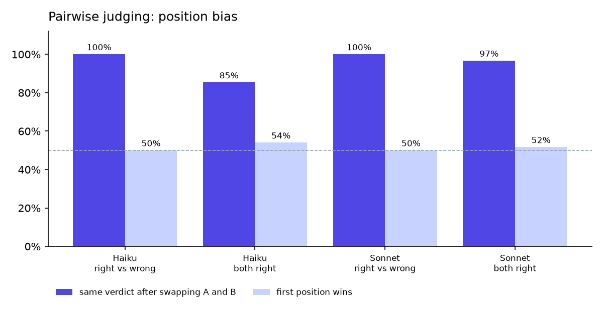

# Results: Judging the Judge

Run on 2026-11-21 with Claude Haiku 5.5 and Claude Sonnet 5.5 as judges (effort `low`, structured output). **7,200 judgements, USD 6.97** (pilot included): 200 replies × 5 designs × 2 models × 3 repeats, plus 100 pairs × 2 orders × 2 models × 3 repeats. No errors, no unparsed responses, no duplicate rows. Every number below comes from [`results/judgements.jsonl`](results/judgements.jsonl) through `uv run python -m judge_the_judge.report`.

## The headline

**Every judge caught every failure. The errors all went the other way: good replies failed, almost all of them by the cheaper judge.** All 10 combinations of design and model caught all 40 wrong replies, all five failure types, on every repeat. What separated them was the true-negative rate, the share of correct replies passed:
- **Sonnet** passed 97–100% of the correct replies.
- **Haiku** passed 82–94%, depending on the design.

The single biggest failure was **critique first**, the design the article suggests for readability. It made Haiku fail 65% of the correct escalation replies. In its critique, Haiku argued itself into a stricter reading of the policy than the policy says: the reply should also confirm that the return is eligible.

| Design | TNR Haiku / Sonnet | κ Haiku / Sonnet | Correct refund replies passed, short vs long (Haiku) | Self-consistency Haiku / Sonnet | Sonnet cost, 600 judgements |
|---|---|---|---|---|---|
| `pf` pass/fail | 94% / 100% | 0.87 / 1.00 | 85% vs 92% | 94% / 100% | $0.94 |
| `pf-crit` critique first | **82%** / 100% | 0.65 / 1.00 | 100% vs 95% | 84% / 100% | **$1.61** |
| `pf-neutral` length-neutral | 91% / 100% | 0.81 / 1.00 | 92% vs 85% | 91% / 100% | $0.97 |
| `score` 1–10, gate ≥ 7 | 91% / 99% | 0.79 / 0.98 | **70% vs 98%** | 92% / 100% | $0.87 |
| `multi` three criteria | 92% / 97% | 0.83 / 0.93 | 88% vs 92% | 88% / 97% | $1.02 |

TPR was 100% for every row (95% interval 91–100% with 40 failures).





## A design flaw, and how the analysis handles it

When I built the correct replies, I cycled outcome and length together. As a result, **every correct escalation reply is short and every correct decline reply is long.** Comparing short with long correct replies overall therefore mixes up length and outcome, and my first report did exactly that. Length is balanced only:
- within the 40 wrong replies (4 short and 4 long per type);
- within the 80 correct refund replies (40 short, 40 long);
- in the pairwise set (a short and a long reply to the same ticket).

**Every length claim below uses only those subsets,** and the escalation and decline pass rates are reported per outcome, not per length. A rerun with a crossed design would let the full set speak to length.

## The hypothesis, claim by claim

**1. Raw agreement flatters the judge (TPR well below agreement): wrong, here.** TPR was 100% everywhere, above raw agreement (86–96% for Haiku). Raw agreement hid a problem in the other direction. Haiku's critique-first judge agreed 86% of the time while failing 65% of the correct escalation replies. The article's broader point holds: one accuracy number hides which way the judge errs. Here it hid false alarms, not misses.

**2. A 1–10 score ranks better than it gates: partly.** At the ≥ 7 gate, κ was below pass/fail on both models (Haiku 0.79 vs 0.87, Sonnet 0.98 vs 1.00). Spearman ρ against the three-level severity label was only moderate, 0.71 and 0.75, so the score didn't rank especially well either. Its clearest weakness was length: Haiku's score passed 98% of long correct refund replies and 70% of short ones.

**3. One criterion beats three: wrong on catch rate; the cost shows in false alarms.** The three-criteria judge caught 100% of the policy failures, the same as one criterion. Its cost was in the other direction. It failed good replies as "incomplete" or for tone: Sonnet's TNR fell from 100% to 97%, and its pass rate on correct escalation replies to 90%.

**4. Judges are verbose-biased, and length-neutral wording reduces it: partly.** No long wrong reply ever passed (0 of 20 under every design and model). Long padding didn't sneak a bad answer through. But Haiku did tilt towards long *correct* replies: plain pass/fail passed 92% of long refund replies against 85% of short ones. Length-neutral wording removed the tilt (92% short, 85% long). Sonnet showed no tilt. In pairwise judging both models went the other way, preferring the **short** reply 93% (Haiku) and 98% (Sonnet) of the time when both were correct.

**5. Pairwise verdicts carry a position bias: partly, small.** No verdict ever flipped when one reply was wrong (100% swap-consistent). Between two correct replies, Haiku's verdict flipped on 15% of swaps and Sonnet's on 3%. The first position won 54% and 52% of the time, which is little more than chance.

**6. A measured change is the real change scaled by (TPR + TNR − 1): confirmed.** In the gate simulation, a true rise in the failure rate from 10% to 15% (+5.0 points) measured as +4.2 points with Haiku's critique-first judge, where the factor predicts +4.1. Sonnet's pass/fail judge measured the full +5.0. Across all ten judges, measured and predicted changes agreed to within 0.2 points.

**7. Critique first doesn't hurt and may help: wrong for Haiku.** For Haiku it cut TNR from 94% to 82%, and its pass rate on correct escalation replies from 100% to 35%. Writing the critique first led it to a stricter reading of the criterion. For Sonnet it changed nothing, at 72% more cost per judgement.

**Not tested, as stated in advance:** self-enhancement bias. It needs a judge from a different model family from the generator, and these replies were templated.

## What the run showed that the hypothesis didn't ask

**The criterion was ambiguous, and calibration found where.** The policy says Support escalates refunds above USD 500 "and tells the customer so", and the correct escalation reply does exactly that. Haiku, especially when it wrote a critique first, read the criterion as also requiring the reply to say the return was eligible. Sonnet didn't. The article says this is what calibration is for: sharpen the criterion and measure again. One added sentence ("an escalation reply passes without restating eligibility") would likely remove most of Haiku's false alarms.

**The cheaper judge was less consistent, not only less accurate.** Haiku gave the same verdict on all three repeats for 84–94% of cases, Sonnet for 97–100%. Majority voting over repeats did real work for Haiku. It also cost about 11× less per judgement.

## What this does and doesn't show

- **It shows** that on a clear, single-criterion policy check, both judges catch blatant failures reliably. The calibration question that mattered was false alarms: whether the judge fails good replies, and why.
- **The failures were blatant by design:** a wrong amount, a refund that shouldn't happen, an invented credit. Subtler failures (a correct outcome with misleading wording) are where catch rates would drop and the article's TPR warning would bite.
- **Limits:** templated replies, 40 failures (so TPR's interval is 91–100% even at 40/40), one criterion, two judges from one family, and the outcome-length confound above.

## Next steps

- Sharpen the criterion for escalations and rerun Haiku's critique-first judge.
- Subtler failures: right outcome with hedged or misleading wording, partial amounts, wrong timelines.
- A crossed design (every outcome × both lengths), and a judge from another model family to test self-enhancement.

## Reproduce

```bash
uv sync
uv run pytest
uv run judge-the-judge --dry-run
uv run python -m judge_the_judge.report   # rebuilds every table and chart from the committed judgements
```
