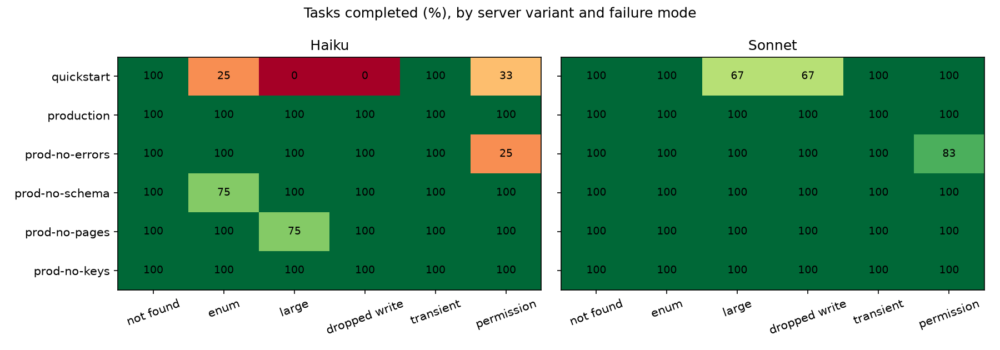
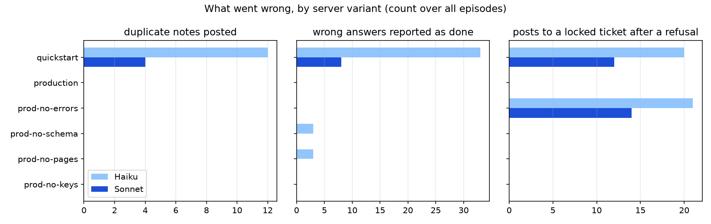

# Results: The Unhappy Path

Run on 2026-11-21 with Claude Haiku 5.5 and Sonnet 5.5 (effort `medium`). **864 episodes (24 tasks × 6 server variants × 2 models × 3 repeats), USD 3.04.** Every episode ended with an answer, and there are no duplicate rows. **USD 3.08** with a first pilot I discarded (next section). Every number below comes from [`results/episodes.jsonl`](results/episodes.jsonl) through `uv run python -m unhappy.report`.

## The headline

**The production server finished every task, on both models. The quickstart finished 43% on Haiku and 89% on Sonnet.**

Of the article's four practices:
- **Pagination signals:** they mattered most for the weaker model, which otherwise reported a truncated list as complete.
- **Strict schemas:** they stopped every invented filter value.
- **Actionable errors:** they mattered mainly for refusals.
- **Idempotency keys:** these were the surprise. Without them nothing was duplicated, because an honest error message and a readable ticket were enough.

| Server | Haiku | Sonnet | Duplicate notes (H / S) | Wrong answers reported as done (H / S) | Extra posts to a locked ticket (H / S) |
|---|---|---|---|---|---|
| `quickstart` | **43%** | **89%** | 12 / 4 | 33 / 8 | 20 / 12 |
| `production` | **100%** | **100%** | 0 / 0 | 0 / 0 | 0 / 0 |
| `prod-no-errors` | 88% | 97% | 0 / 0 | 0 / 0 | 21 / 14 |
| `prod-no-schema` | 96% | 100% | 0 / 0 | 3 / 0 | 0 / 0 |
| `prod-no-pages` | 96% | 100% | 0 / 0 | 3 / 0 | 0 / 0 |
| `prod-no-keys` | 100% | 100% | **0 / 0** | 0 / 0 | 0 / 0 |

Each cell covers 72 episodes per model.




## Two flaws found in the pilot, and how the run handles them

**1. The not-found tasks were ambiguous.** In the first pilot the agent usually *did* find the customer's real ticket, even behind an opaque error. Then it stopped to ask: *"the ID differs from the one you gave… Please confirm whether T-000060 is correct."* That is a defensible choice, and my grader scored it a failure. The prompt now says *"They may have the ticket number wrong."*

**2. The agent couldn't check whether a write had landed.** In `prod-no-keys`, Haiku read the ticket after the timeout, *"confirmed the note was not there"*, and resent it. But `get_ticket` showed only customer messages, never comments, so that check could never work. A real ticketing API shows a ticket's notes, and `get_ticket` now does too, which makes "check before resending" a real alternative to keys.

I discarded that pilot (USD 0.04; kept in [`results/pilot-v1/`](results/pilot-v1)), added a test for each fix, and reran the pilot. Its 72 episodes are part of the matrix; the code didn't change after it.

## The hypothesis, claim by claim

**1. The production server beats the quickstart: confirmed.** 100% against 43% on Haiku and 89% on Sonnet. The production server was also the cheapest per Sonnet episode ($0.0059 against $0.0095), because the agent needed fewer calls (1.7 against 3.2).

**2. Actionable errors drive recovery: partly. They mattered for refusals, not for not-found or transient failures.**
- **Locked tickets:** told *"Retrying won't help; tell the user"*, both models stopped after one attempt in all 96 episodes on the four servers with actionable errors. After "Request failed." they tried two or three times: 21 extra posts on Haiku and 14 on Sonnet. Every episode still ended by telling the user.
- **Not found and transient:** opaque errors didn't stop recovery. After a bare "Request failed." on a non-existent ticket, every quickstart agent searched for the ticket, found the real one and added the note (24 of 24). Every timeout and rate limit was retried successfully on every variant.

**3. Strict schemas stop silent wrong answers: partly.**
- **Free strings drew invented values almost every time:** "closed", "critical", "waiting on customer", "on hold". Haiku did it in 17 of 24 enum episodes, Sonnet in 24 of 24. With the enum in the schema (`production`): 0 of 24.
- **What happened next depended on the model.** Sonnet noticed the empty result, searched without the filter, read the real values and answered correctly every time. Haiku sometimes took "No tickets match." as fact. On `prod-no-schema` it reported **0 closed critical tickets three times out of three** (the answer is 12). The article's *"some guesses succeed at the wrong thing"* is exactly what happened.

**4. Without a total, the model treats a truncated list as complete: partly; the weaker model did, the stronger one worked around it.**
- **Haiku on `quickstart`** answered **20** on 11 of 12 large-count tasks. That is the page size, though it asked for 100 or more, which was silently capped. The right answers were 21–45.
- **Sonnet split the question:** it ran one search per priority or channel, each under a page, and added them up. That gave it 100% on `prod-no-pages` and 67% on `quickstart`.
- **Haiku on `prod-no-pages`** split too, where the schema listed the values, but still missed 3 of 12 (20, 19 and 44, against 21, 34 and 45).

**5. Without idempotency, a dropped write produces duplicates: partly. Only when the error was opaque.**
- **On `quickstart`**, after "Request failed.", Haiku resent without checking in 11 of 12 episodes and **duplicated the note in all 12**. Sonnet read the ticket first 8 times out of 12 and duplicated 4.
- **On `prod-no-keys`**, the message was honest: *"Comment unconfirmed… may or may not have been posted."* Both models read the ticket, saw the note, and didn't resend, in all 24 episodes. **No duplicates without keys.**

Keys are the defence that doesn't depend on the model choosing to check. But in this run, an honest error and a ticket that shows its notes did the same job.

**6. A permission error isn't retried when the message says so: confirmed.** Told that retrying wouldn't help, both models made exactly one attempt (96 of 96). After an opaque refusal they made two or three.

## What the run showed that the hypothesis didn't ask

- **The quickstart's damage is concentrated in the weaker model.** Sonnet compensated for almost every missing practice: it searched after opaque errors, explored instead of trusting an empty result, split oversized queries, and checked before resending. Haiku compensated for some. The production practices raised both models to 100%, and the gap between the models disappeared.
- **Wrong answers, not errors, were the main cost.** On `quickstart`, Haiku reported 33 tasks as done that weren't: undercounts, zero counts, duplicated notes. Every one looked like success.

## What this does and doesn't show

- **It shows** that the failure-path practices in the article take a quickstart server from 43% to 100% for Claude Haiku 5.5 and from 89% to 100% for Sonnet 5.5, on the article's own example. Each practice prevents a specific, visible failure.
- **It doesn't show** that idempotency keys are unnecessary. Here the agent could read back what it wrote and the message was honest. Where a write can't be read back, or the agent is in a hurry, keys are the only defence.
- **Limits:**
  - one ticketing domain and 24 tasks, with one failure each;
  - two models from one family;
  - errors kept short;
  - Python SDK v2 only, whose validation errors already name the field even on `prod-no-errors`.

## Next steps

- Writes that can't be read back (a sent email, a payment), so only idempotency keys can prevent duplicates.
- Tasks that combine failures, such as a not-found ticket followed by a dropped write.
- Free-string schemas whose descriptions list the values, to separate "the enum is visible" from "the server rejects a wrong value".

## Reproduce

```bash
uv sync
uv run pytest
uv run unhappy-path --dry-run
uv run python -m unhappy.report   # rebuilds every table and chart from the committed episodes
```
