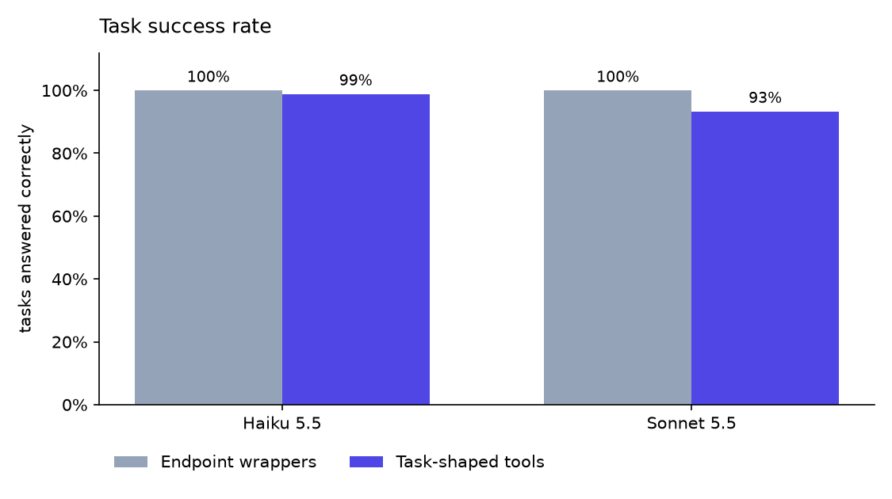
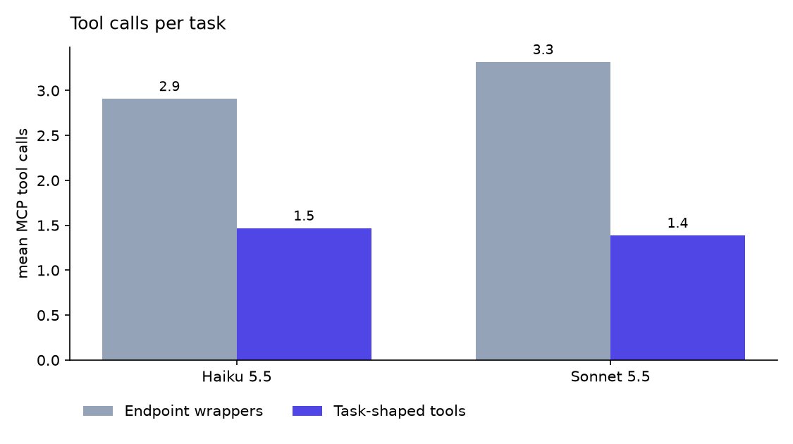
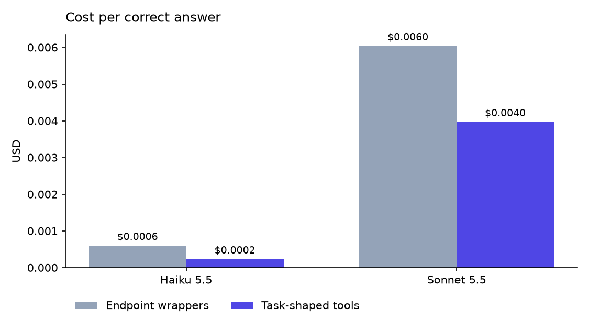

# Results: run of 20 November 2026

360 episodes: 30 tasks × 2 tool designs × Claude Haiku 5.5 and Claude Sonnet 5.5 × 3 repeats, effort `medium`, prompt caching on. Total spend **USD 0.95**. Every number below comes from [`results/episodes.jsonl`](results/episodes.jsonl) through `uv run python -m tool_shape.report`; run metadata is in [`results/run.json`](results/run.json).

## Headline

| Model | Design | Success | Tool calls / task | Input tokens / task | Cost per correct answer | Median latency |
|---|---|---|---|---|---|---|
| Haiku 5.5 | Endpoint wrappers | **100%** (90/90) | 2.91 | 7,927 | $0.00060 | 4.9 s |
| Haiku 5.5 | Task-shaped tools | 99% (89/90) | **1.47** | **3,146** | **$0.00023** | **2.9 s** |
| Sonnet 5.5 | Endpoint wrappers | **100%** (90/90) | 3.32 | 6,277 | $0.00604 | 4.8 s |
| Sonnet 5.5 | Task-shaped tools | 93% (84/90) | **1.39** | **3,123** | **$0.00397** | **3.4 s** |

No episode hit a tool error, the circuit breaker, the turn limit or an API error. One episode needed the "please answer" reminder.





## Against the hypothesis

The hypothesis, written before the run: *task-shaped tools give a higher task success rate with fewer tool calls and fewer tokens, and the gap is wider on a smaller model.*

| Claim | Verdict | Evidence |
|---|---|---|
| Higher success rate | **Not supported** | Endpoint wrappers scored 100% on both models. Task-shaped tools scored 99% and 93%. |
| Fewer tool calls | **Supported** | 49% fewer on Haiku (2.91 → 1.47), 58% fewer on Sonnet (3.32 → 1.39). |
| Fewer tokens | **Supported** | 60% fewer input tokens on Haiku, 50% on Sonnet; output tokens down 35–37%. |
| Gap wider on the smaller model | **Mixed** | Wider for tokens (−60% vs −50%) and cost per correct answer (2.6× vs 1.5× cheaper). Narrower for tool calls. No success-rate gap to compare. |

## Why the task-shaped tools lost points

All seven misses are on the task-shaped server, and all are on the same two tasks: **`delivery-5` and `ticket-5`, the only two tasks about an order that is still in transit.**

- The endpoint tool `get_order_shipment` returns the shipment record as stored, including `"late": false`. The dataset only marks a shipment late once it is delivered after its promise date.
- The task-shaped tool `order_status` was written to drop that field for undelivered orders, since "late" seemed meaningless before delivery. It says: *"promised by 2025-02-07 … Delivered: no, still in transit."*
- Asked "was it late?", Sonnet saw a promise date long in the past and no delivery, and answered **late: true**, every time (6/6). Haiku answered correctly five times out of six and once stopped without answering.

Which answer is "right" depends on what "late" means. A support agent would probably call an order nine months past its promise date overdue. Still, the lesson for tool design is the same either way: **a task-shaped tool decides what the agent gets to know. When it leaves a fact out, the model fills the gap with its own reading, and you no longer control which reading.** The endpoint wrapper passed simply because it showed the raw field and let the model repeat it.

The benchmark's own safeguard, a test that every task-shaped tool agrees with ground truth, didn't catch this. It checked the fields the tool *printed*, not the ones it left out.

## Other observations

- **The extra calls on endpoint wrappers are mostly exploration, not necessity.** On ticket triage, Sonnet made 4.5 calls with endpoint tools against 1.1 with task-shaped ones, often reading `list_policies` and `get_policy` when the task needed no policy at all. Haiku explored less (2.5 calls).
- **The token saving comes from two places.** Endpoint episodes took more turns (about 3 against 2), and every turn re-sends the tool definitions and the growing conversation. Raw JSON results also take more tokens than one-line answers. Prompt caching makes the repeated prefix cheap, but not free.
- **The returns trap didn't spring.** Both designs got all 24 return-eligibility episodes right on both models, including the trade customer's 14-day window. With well-written descriptions, both models found and applied the returns policy through raw endpoints.
- **These tasks were too easy to separate the designs on accuracy.** Most need one to three lookups. Tasks needing more joins, or more distracting endpoints, are where a success gap would show, if there is one.

## What I'd change in a second run

1. Make `order_status` say what it means for undelivered orders (for example, "Late: not yet; promise date has passed, shipment overdue"), and re-run only the task-shaped design to see whether the misses go away.
2. Add harder multi-hop tasks (three or more records) and a larger endpoint surface, so accuracy can separate the designs.
3. State "today" in every task prompt, not only the return tasks, so no answer depends on the model's sense of the date.

## Reproduce

```bash
uv sync
uv run --env-file .env tool-shape --models haiku,sonnet --repeats 3 --max-usd 5
uv run python -m tool_shape.report
```

Model outputs vary between runs, so expect small differences in the exact counts.
