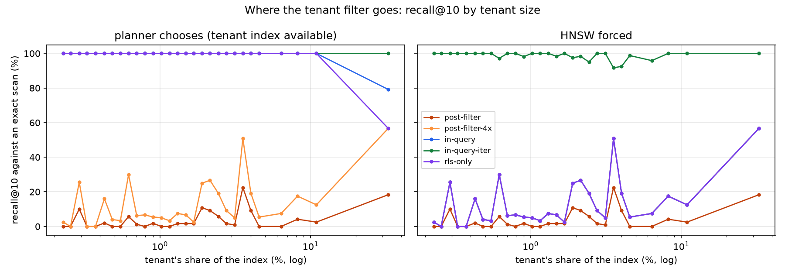
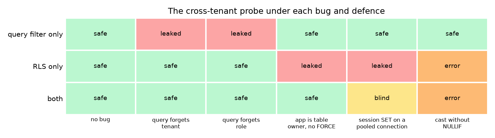
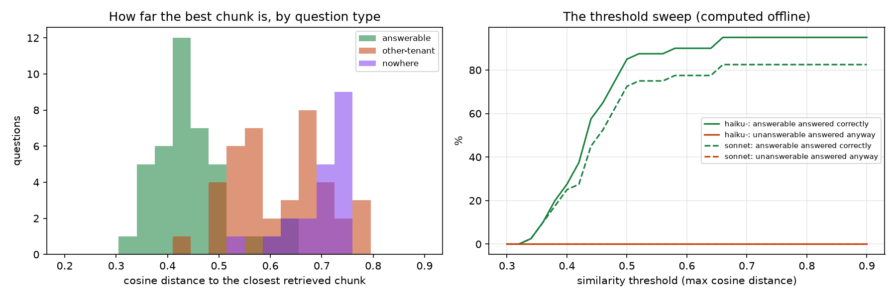

# Results: Filter Before You Rank

Run on 2026-11-21 on PostgreSQL 18 + pgvector 0.8.1, with `voyage-4-lite` embeddings and Claude Haiku 5.5 and Sonnet 5.5. **About USD 0.50 in all:**
- Study C: USD 0.47, 400 answers;
- four diagnostic calls: about USD 0.02;
- embedding 0.54M tokens: a few cents.

Studies A and B need no model. The throwaway database and its roles were dropped afterwards, and the CMS database was untouched. Every number below comes from `results/` through `uv run python -m fbr.report`.

## The headline

**Where the filter goes decides whether a tenant gets its answers.**
- **Post-filtering:** filtering a global top-10 in the app returned **4%** of the right chunks, and under 2% for small tenants.
- **The filter inside the query, on a plain HNSW scan:** no better than post-filtering a top-40.
- **Iterative scans:** these, the tutorial's setting, restored **98.5–100%**.
- **The layers:** row-level security caught exactly the bugs the query filter missed, and the reverse, as the tutorial reasons.
- **Refusals:** neither model ever answered from a chunk that didn't support it, so the similarity threshold had nothing to prevent and could only refuse good answers.

| How the tenant filter is applied (k = 10) | Recall, HNSW forced: all / small tenants | Recall, planner chooses: all / largest tenant |
|---|---|---|
| post-filter (global top 10, then the app filters) | 4% / 2% | 4% / 18% |
| post-filter, oversampled 4× | 14% / 9% | 14% / 57% |
| filter in the query, iterative scans off | **14%** / 9% | 99% / **79%** |
| filter in the query, `hnsw.iterative_scan = relaxed_order` | **98.5% / 99.4%** | **100% / 100%** |
| RLS policy only (no WHERE) | 14% / 9% | 98% / **57%** |

There were 287 tenant-scoped questions across 30 tenants. Small means under 1% of the index (71 questions); the largest tenant holds 32.8%. The exact scan was checked against numpy on all 1,148 runs.



## The hypothesis, claim by claim

**1. Post-filtering starves small tenants: confirmed, and badly.** A global top-10 filtered in the app kept **0.4** of the 10 results asked for, on average: 4% recall, and 1.7% for small tenants. Oversampling to a top-40 helped a little (14%; 9% for small tenants). Even the largest tenant got only 18%, because the other 29 tenants' chunks on the same subtopic crowd out its own.

**2. Filtering inside the HNSW query without iterative scans still under-returns; iterative scans fix it: confirmed, with a sharper reason.**
- **On a plain HNSW scan,** `WHERE tenant_id = …` returned **1.4 of 10** results (14% recall). That is exactly the same as post-filtering a global top-40, in every tenant band. The cause: an HNSW scan hands back `ef_search` candidates (40 by default), and the `WHERE` clause filters only those. Without iterative scans, "filter in the query" *is* post-filtering at a slightly larger k.
- **With iterative scans:** recall was 98.5%, and 99.4% for small tenants.
- **The cost** is latency on the smallest tenants: 11.8 ms against 0.4 ms. The scan keeps walking the graph until it finds enough of a tenant's rows.
- **When the planner may choose,** it answers small tenants from the plain tenant index (exact, 0.6 ms), so the problem disappears there. It still uses HNSW for the largest tenant, whose filter isn't selective, and that tenant lost 21% of its results.

**3. RLS alone behaves like a post-filter on an HNSW index: confirmed, and it is worse than the explicit filter.** With HNSW forced, the RLS-only query matched the in-query filter result for result. When the planner chose, RLS-only did *worse* for the largest tenant (57% against 79%): the policy's condition was less useful to the planner than an explicit `WHERE`. The tutorial's design is the right one: keep the filter in the query and treat RLS as the backstop.

**4. Each layer alone misses a bug the pair catches: confirmed, cell for cell.**



- **The query filter alone** leaked when the query forgot the tenant or the role filter. A forgotten tenant filter only showed up when the probe used a document the asker's role may see. Probing with a runbook let the role filter hide it, a mistake in my own first probe.
- **RLS alone** leaked when the app connected as the table owner without `FORCE`, and when an earlier request had set the principal with session-level `SET` on the same pooled connection. Without `NULLIF`, a connection whose earlier transaction had set the principal raised `invalid input syntax for type uuid: ""`, failing closed with an error.
- **Both together** were safe against every bug except two:
  - the session `SET`, which left the caller **blind**: the query filter said Acme, the stale setting said Globex, and nothing came back;
  - the missing `NULLIF`, which still errored.

  No bug leaked through both layers.

**5. Without a threshold the model sometimes answers what its chunks don't support: wrong, here.** Across 240 answers to questions the asker's documents couldn't answer, **neither model answered once**. That includes 160 whose answer sat in another tenant's documents, behind the filter. Every reply was `NO_ANSWER`. So the threshold had nothing to prevent.

On the same answers, a threshold would only have refused good ones: at a maximum distance of 0.5 it would have turned away 12.5% of the answerable questions, and at 0.4 almost three quarters. The closest-chunk distances of answerable and unanswerable questions overlap (0.34–0.65 against 0.43–0.79), so no threshold separates them cleanly.



**6. The citation check is a floor: not tested, because nothing reached it.** None of the 400 answers cited a chunk that wasn't in the prompt. Every correct answer cited a chunk that contained its fact. The check is still the right floor, but these runs never gave it anything to catch.

## What the run showed that the hypothesis didn't ask

- **The strict refusal rule cost answers, mostly on the stronger model.**
  - **Haiku** answered 76 of 80 answerable questions. Two of its four refusals were a retrieval miss: none of the five chunks was on the right subtopic.
  - **Sonnet** answered 66 of 80. It refused 12 questions whose five chunks *all* contained the answer: "How do I invite a teammate?", "How much storage is included?". Every chunk names a specific plan and region, and under "answer only from the chunks", Sonnet declined to generalise a fact that was in fact the same across all of them.
  - Raising its effort from low to medium answered one of the two I retried, not the other.

  This is the opposite failure from the one the threshold guards against.
- **A transaction can outlive the request it belongs to.** While building the harness, a connection outside autocommit turned my per-request transaction into a savepoint inside an implicit outer transaction, and `SET LOCAL` kept the tenant set after the "request" ended. A connection pool that hands out connections already inside a transaction would leak the same way. The tutorial's "transaction-local" advice assumes each request really is its own transaction.

## Two flaws found during the run

- **A grader too strict on wording.** The fact "on the Enterprise plan only" was written by both models as "only on the Enterprise plan". My exact-substring check marked four correct answers wrong. Facts now match on their words in any order. I re-graded the stored answers with no new calls, and a test covers it.
- **A probe that hid a leak,** described under claim 4, fixed before the published run.

## What this does and doesn't show

- **It shows,** on a shared index of 30 tenants with real embeddings:
  - filtering after ranking, or inside a plain HNSW scan, loses most of a tenant's answers;
  - iterative scans recover them;
  - RLS is a backstop, not a retrieval filter;
  - each isolation layer covers the other's bugs.

  The tutorial's design holds up on every retrieval and isolation claim.
- **It doesn't show** that the refusal threshold is useless in general. These models, with this prompt, never answered unsupported questions. A weaker model, a looser prompt, or chunks that *almost* answer the question might.
- **Limits:**
  - one synthetic corpus with templated text, and 30 tenants;
  - pgvector defaults (`m = 16`, `ef_search = 40`);
  - 100 Study C questions;
  - two models from one family.

## Next steps

- Raise `ef_search` and measure the recall and latency trade-off against iterative scans.
- Near-miss questions, where the chunks are about the right subtopic but not the asked detail, to give the threshold and the citation check something to catch.
- A prompt that allows a general answer when every chunk agrees, to see whether Sonnet's over-refusals go away.

## Reproduce

```bash
uv sync
export DATABASE_URL_ADMIN=postgresql://postgres@localhost:5432/postgres
uv run pytest
uv run filter-before-rank --dry-run
uv run python -m fbr.report   # rebuilds every table and chart from the committed results
```
