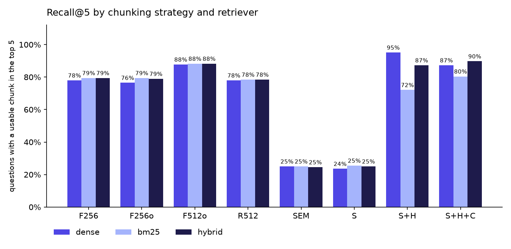
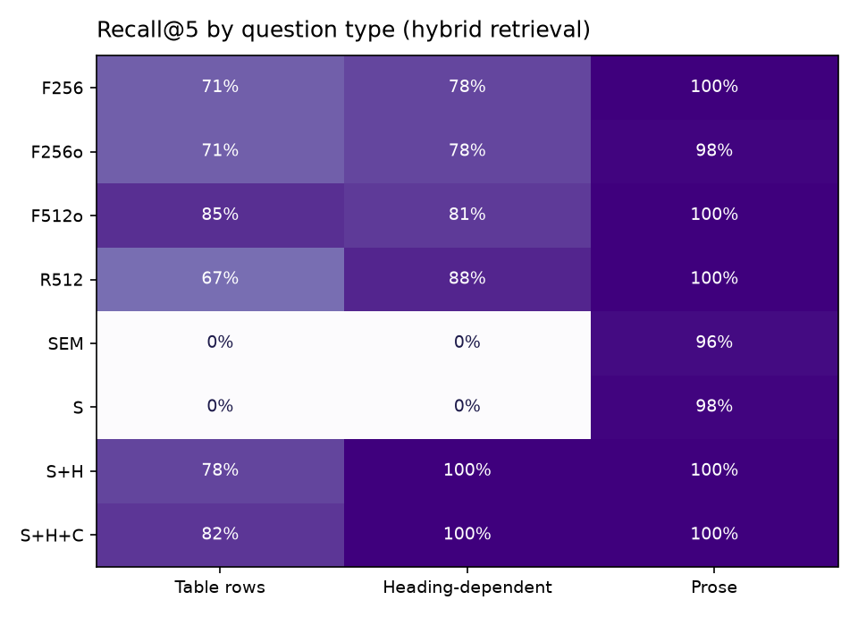
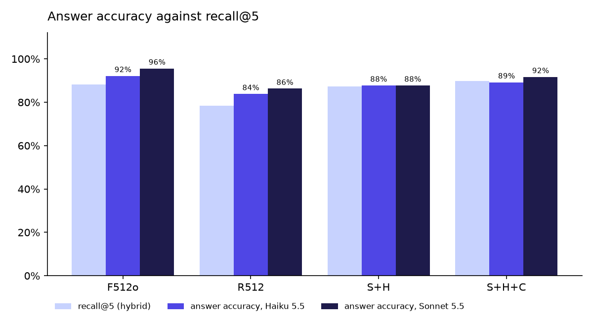

# Results: Cut Here

Run on 2026-11-20. Retrieval used a local embedder (BAAI/bge-small-en-v1.5), BM25 and hybrid, for $0. Contextual retrieval used Claude Haiku 5.5 on 235 chunks ($0.026). End-to-end answers used Claude Haiku 5.5 and Sonnet 5.5: 1,632 answers ($3.76). **Total paid: USD 3.78.** Every number below comes from the files in [`results/`](results) through `uv run python -m cut_here.report`.

## The headline

**The heading path did most of the work, and the common default was harder to beat than I expected.** Splitting by structure without the heading path was a disaster: 25% recall@5, with the right table row coming back but never saying which product or carrier it belonged to. Adding the path took the same 235 chunks to 87% (95% with dense retrieval). The plain 510-token fixed chunks with 15% overlap matched it on recall (88%) and **beat it on end-to-end answers** (Sonnet 96% vs 88%). On this corpus a 510-token chunk is about a whole product page, so the context rides along, and the answering model can piece together what one chunk lacks from the other four. It costs 2.5× as much per answer, though, and some of those right answers rest on guesses the passages don't support.

| Strategy | Chunks | Recall@5 hybrid (dense / BM25) | Heading-dependent | Tables | Answers, Haiku / Sonnet | Sonnet cost, 204 answers |
|---|---|---|---|---|---|---|
| F256 fixed 256 | 95 | 79% (78 / 79) | 78% | 71% | – | – |
| F256o fixed 256, 50% overlap | 102 | 79% (76 / 79) | 78% | 71% | – | – |
| F512o fixed 510, 15% overlap | 51 | 88% (88 / 88) | 81% | 85% | **92% / 96%** | $1.23 |
| R512 recursive 510 | 53 | 78% (78 / 78) | 88% | 67% | 84% / 86% | $1.20 |
| SEM semantic | 386 | **25%** (25 / 25) | 0% | 0% | – | – |
| S structure-aware | 235 | **25%** (24 / 25) | 0% | 0% | – | – |
| S+H + heading path | 235 | 87% (**95** / 72) | **100%** | 78% | 88% / 88% | **$0.48** |
| S+H+C + contextual retrieval | 235 | **90%** (87 / 80) | 100% | 82% | 89% / 92% | $0.67 |

Recall here is strict: a top-5 chunk must cover the answer's span **and** carry what disambiguates it (the product, the warehouse, the carrier and region). The right row with no product name doesn't count.





## The hypothesis, claim by claim

**1. S+H beats fixed-size and recursive splitting on recall@5, mostly on tables and headings: partly.** With hybrid retrieval, S+H beat fixed 256 (87% vs 79%) and recursive (78%), but only matched fixed 510 with overlap (88%). With dense retrieval alone it led clearly: 95% against 88%, 78% and 78%. Where it won, it won on heading-dependent questions: 100% against 78–88%. A shipping-rate row needs both its carrier and its region, which only the headings give.

**2. Without the heading path, small chunks fail on tables: confirmed, completely.** The same chunks went from 0% to 100% on heading-dependent questions and from 0% to 78% on table rows when the path was prefixed, while prose stayed at 98–100%. Plain S retrieved the right passage 58% of the time, but in none of those cases did the chunk say what it was about.

**3. Overlap raises fixed-size recall but doubles the chunk count: wrong, on this corpus.** 50% overlap added 7% more chunks (95 to 102) and 46% more embedded tokens, and recall didn't move: 79% hybrid both ways, and slightly worse with dense (78% to 76%). These pages are short; there were few boundaries for overlap to protect.

**4. Semantic chunking is no better than S+H, at a higher index-time cost: confirmed, and much worse.** 25% recall@5 against 87%, with the most chunks (386) and the slowest index of the free strategies. Cutting where sentence similarity drops split tables into loose rows and separated headings from what they head, which is the article's warning that "a similarity signal has no notion of a table header."

**5. Contextual retrieval reduces failures on top of S+H, but by less than Anthropic's 35%: partly, and it hurt dense retrieval.** Failures fell 19% with hybrid retrieval (12.7% to 10.3%) and 30% with BM25 (27.9% to 19.6%), but **rose 160% with dense retrieval** (4.9% to 12.7%). The reason is visible in the contexts. Haiku accurately copied facts from elsewhere in each document into the context: 110 of 200 product chunks gained one, and all 109 warranty figures it stated were correct. So the Warranty prose section's chunk now said "covers the 3-year warranty", and it outranked the specifications row that actually holds the value. End to end, it still came out ahead of plain S+H: 92% against 88% on Sonnet.

**6. Recall@5 predicts end-to-end accuracy, with the same ranking: partly.** Recursive was last on both, and S+H+C beat S+H on both. But the top two swapped: F512o was second on recall and first on answers. Its 15 Sonnet answers that were right without a strict retrieval hit show the model stitching context together across passages. One spot-checked case was "0 units at Main (Riverside)": the right row came back without its warehouse name, the warehouse came from another passage, and the two warehouse tables look identical. That answer was right, but the passages didn't prove it.

## What the run showed that the hypothesis didn't ask

**BM25 needs the words, dense needs the meaning.** S+H with BM25 alone scored 52% on table questions against 93% for dense: "What is it *made of*?" doesn't share a word with "*Material*". The heading path pays off with semantic retrieval, and hybrid lands in between.

**Small chunks are cheaper to answer from.** At top-5, the S+H passages cost 2.5× less per Sonnet answer than the 510-token chunks ($0.48 vs $1.23 for 204 answers). That holds at equal recall, before any reranking.

**Honest "not found" answers come from clean chunks.** When S+H retrieved only a near-duplicate product's table, Sonnet answered "not found". When a fixed-size chunk held the row without its warehouse name, the model sometimes guessed correctly anyway. A guess that happens to be right is still a risk in production.

## What this does and doesn't show

- **It shows** the article's main mechanism clearly: on structured documentation, a chunk that doesn't say what it is about can't be found or used. The heading path is the cheapest fix there is: one line, no model, and +62 points of recall.
- **The corpus is small and generated** (47 documents, about 11,400 words, built from the Kestrel data). Short pages flatter big fixed chunks, because a 510-token chunk is often a whole page. On long documents, the advantage of big fixed chunks should shrink, and their cost should grow.
- **Strict grading under-credits big chunks end to end,** because a reader with five passages can combine them. Both views are reported: span-plus-context recall, and answer accuracy.
- **One embedder, one corpus, one set of templated questions,** and contexts from a single run. Retrieval is deterministic; contexts and answers would vary slightly on a rerun.

## Next steps

- A long-document corpus (manuals, specifications) where pages are many chunks long.
- Prefix the heading path to the context-free strategies too (F512o+H), to separate "big chunk" from "carries its heading".
- A reranker over a top-20 candidate pool, as the article's pipeline diagram shows.
- Write contexts that describe the chunk rather than copy facts into it, and see whether dense recall recovers.

## Reproduce

```bash
uv sync
uv run pytest
uv run cut-here --retrieval              # free; matches the committed results exactly
uv run python -m cut_here.report         # rebuilds every table and chart from the committed files
```
