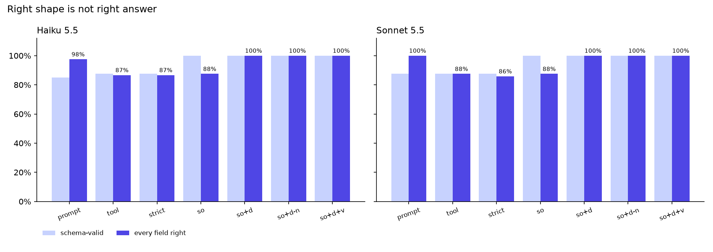
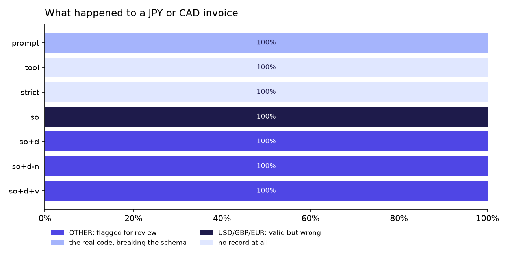
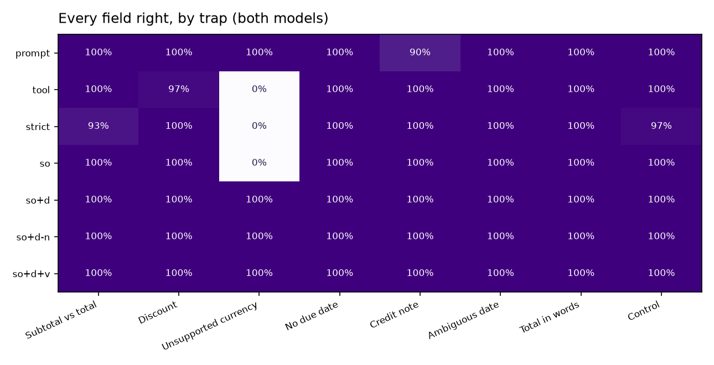

# Results: Right Shape, Wrong Number

Run on 2026-11-20 with Claude Haiku 5.5 and Claude Sonnet 5.5 (adaptive thinking, effort `medium`). **1,680 records, USD 4.87** (pilot included). 120 invoices × 7 conditions × 2 models; no API errors, no duplicate rows. Every number below comes from [`results/extractions.jsonl`](results/extractions.jsonl) through `uv run python -m right_shape.report`.

## The headline

**The models read every value trap correctly. Every error came from the schema.** Across the 1,620 records that came back, there was **not one wrong total, subtotal, invoice date, invoice number or line count**: no subtotal mistaken for the total, no missed discount, no misread `09/10/2025`, no misread amount in words. The article's transposed total never happened on these documents. What failed was the design of the request:

- **A closed currency enum** (USD/GBP/EUR) on a JPY or CAD invoice made structured outputs record **USD on all 30 such records**, schema-valid and wrong. The two tool conditions **didn't call the tool at all** (60 records with no output), and instructions-only wrote the real code, breaking the schema.
- **An optional due date** let the tool conditions **drop a printed due date 4 times**.
- **No sign convention for the discount** led Haiku to record it as negative in 27 base-schema records. The scored fields were still right, but subtotal − discount + tax + shipping no longer equalled the total.

The designed schema (descriptions, `OTHER`, a required-but-nullable due date) took structured outputs from 88% to **100% of records fully right on both models**.

| Condition | Schema-valid, Haiku / Sonnet | Every field right, Haiku / Sonnet | Valid but wrong | Sonnet cost, 120 records |
|---|---|---|---|---|
| `prompt` instructions only | 85% / 88% | 98% / 100% | 0% / 0% | $0.54 |
| `tool` | 88% / 88% | 87% / 88% | 1% / 0% | $0.80 |
| `strict` tool | 88% / 88% | 87% / 86% | 1% / 2% | $0.80 |
| `so` structured outputs, base schema | **100% / 100%** | 88% / 88% | **12% / 12%** | $0.52 |
| `so+d` designed schema | 100% / 100% | **100% / 100%** | 0% / 0% | $0.67 |
| `so+d-n` designed, no `notes` | 100% / 100% | 100% / 100% | 0% / 0% | $0.57 |
| `so+d+v` designed + rules + retry | 100% / 100% | 100% / 100% | 0% / 0% | $0.67 |





## The hypothesis, claim by claim

**1. Structured outputs and strict tools give 100% schema-valid records; instructions and non-strict tools fall short: partly.** Structured outputs were schema-valid on all 960 records across its four conditions. Strict tool use reached only 88%. On every JPY or CAD invoice the model declined to call the tool, and a strict schema only constrains the arguments of a call that happens. As the article puts it, it doesn't guarantee "that the call should happen at all". Instructions-only fell short too (85–88%), mostly by writing `JPY` or `CAD` outside the enum, and three times by spelling `credit note` with a space.

**2. Constrained decoding doesn't fix values; valid-but-wrong records appear, concentrated in the traps: partly.** Structured outputs with the base schema returned valid-but-wrong records at 12% on both models. But every one came from the closed currency enum, not from the value traps the claim names. Subtotal-for-total, discounts, ambiguous dates and amounts in words produced no errors in any condition. Constrained decoding didn't fix values here because there was nothing to fix; what it did was force a wrong value where the schema left no right one.

**3. A closed enum forces a wrong answer; `OTHER` lets the model say "none of these": confirmed, completely.** With the base schema, 30 of 30 JPY/CAD records under structured outputs came back as USD, with the yen or Canadian-dollar amounts left as they were. With `OTHER` in the enum, 90 of 90 came back `OTHER`, ready to route to a person. The same invoice gave four different failures depending only on how the request was made: forced wrong, no record, schema broken, or flagged correctly.

**4. Required-but-nullable beats optional for a missing due date: partly.** No condition ever invented a due date: 0 fabrications in 1,680 records. The optional field failed the other way. The tool conditions dropped a due date that *was* printed in 4 records, which is the article's "the model forgot" case. The required-but-nullable design never did, in 480 records.

**5. An explanation-first `notes` field improves accuracy on the ambiguous traps: not testable.** With and without `notes`, the designed schema scored 100% on both models, so there was no headroom to show a gain. The notes themselves were sensible, for example "Dates read day-first as UK format: issued 2025-10-09". They cost 15–18% more per record.

**6. Business rules catch most of the wrong records the schema can't, and one retry repairs a meaningful share: wrong, on this data.** The schema-valid wrong records were the forced-USD currencies, and they were internally consistent: the arithmetic still added up. The rules caught **none** of them. With the designed schema nothing was wrong, so the validated condition never retried. The rules did flag 27 base-schema records with a negative discount. All 27 were real inconsistencies in a field the grader didn't score, with no true false alarms, and the designed schema's one-line description ("a positive number") prevented every one.

## What the run showed that the hypothesis didn't ask

**Schema design decided more than mechanism did.** The worst schema-valid result (12% wrong) and the best (0%) used the same mechanism: structured outputs. The difference was three schema choices.

**The plainest mechanism was the most accurate with the base schema.** Instructions-only scored 98–100% fully right, the best of the four base-schema conditions, because nothing stopped it from writing `JPY`. Its "invalid" records were mostly correct ones that the schema couldn't hold.

**Structure guarantees what you write down, including your mistakes.** A closed enum is a statement that the answer is one of three values. Constrained decoding enforced that statement on an invoice where it was false.

## What this does and doesn't show

- **It shows** that a schema-valid record is not a correct one, and that on clean documents the errors that remain are often in the schema itself: closed enums, optional fields, unstated conventions.
- **It doesn't show** that value errors don't happen. These were clean, digital, short invoices. Scanned documents, long multi-page invoices and messier layouts are where the article's transposed total is likely, and where business rules earn their keep.
- **Limits:** 120 generated invoices, one repeat per cell, two models, `medium` effort. The `notes` and validation claims need harder documents to test.

## Next steps

- Harder documents: image scans, multi-page invoices with carried-forward totals, handwritten corrections.
- Rerun the `notes` ablation where accuracy has room to move.
- Reverse-check the rules on deliberately corrupted records to measure their true catch rate.

## Reproduce

```bash
uv sync
uv run pytest
uv run right-shape --dry-run
uv run python -m right_shape.report   # rebuilds every table and chart from the committed records
```
